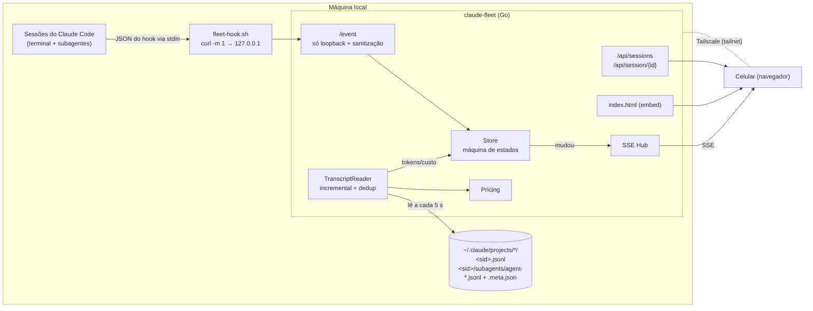
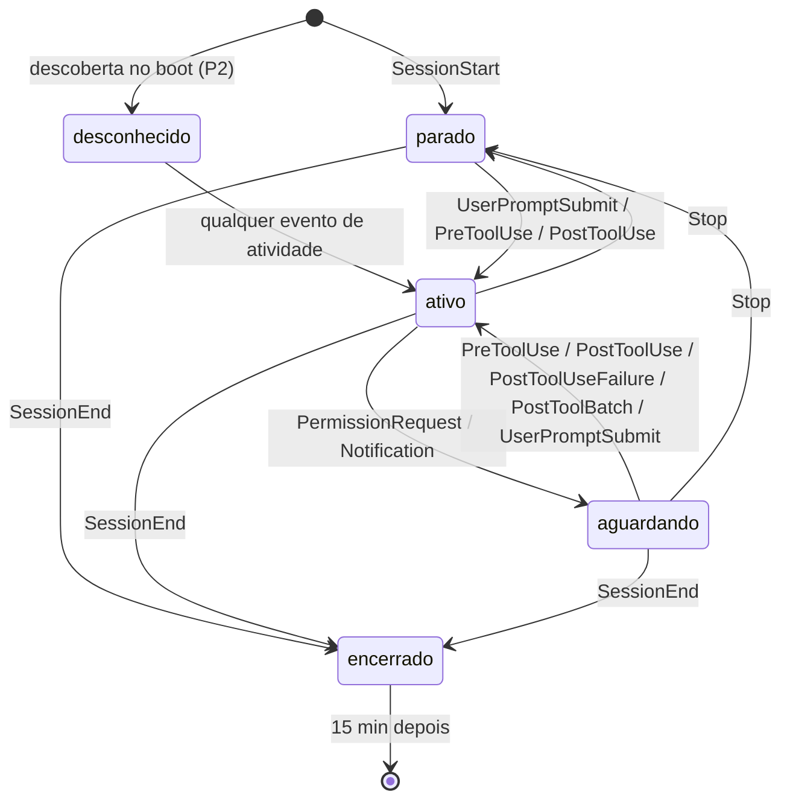

# fleet-mvp Design

**Spec**: `.specs/features/fleet-mvp/spec.md`
**Status**: Draft (aguardando aprovação)

---

## Architecture Overview

Três peças, todas locais: um **hook** minúsculo que o Claude Code chama a cada evento, um **servidor Go** que mantém o estado em memória e lê os transcripts para obter os tokens, e uma **página** embutida no binário que recebe as mudanças por SSE. O celular só enxerga a página, e só através da tailnet.



### Fluxo de estados



Regras complementares (vindas do spike T1):

- `PostToolBatch` também tira a sessão de **aguardando**: quando a permissão é negada, nenhum `PostToolUse` nem `PermissionDenied` é disparado.
- `SessionStart` de uma sessão **já conhecida** não muda o status. Com `source=compact`, ele chega no meio da atividade; com `source=resume`, só atualiza `transcript_path`.
- `PreCompact`, `PostCompact` e `SessionStart` não contam como atividade de ferramenta: só atualizam `LastEventAt`.
- Decisões do T7:
  - **Sessão nova:** quando nasce de um evento que não é `SessionStart`, a sessão começa em **desconhecido** e o próprio evento já é aplicado.
  - **Saída de parado:** qualquer evento de atividade (`UserPromptSubmit`, `PreToolUse`, `PostToolUse`, `PostToolUseFailure`, `PostToolBatch`) leva a **ativo**.
  - **`Notification`:** leva a **aguardando** só a partir de **ativo**. Com a sessão parada, ela é o aviso de ociosidade.
  - **Sessão encerrada:** só reabre com `UserPromptSubmit` (vai para ativo) ou `SessionStart` (vai para parado). Eventos atrasados só atualizam `LastEventAt`.
  - **Eventos fora do diagrama:** `StopFailure` age como `Stop`, e `PermissionDenied` tira de **aguardando**.

Subagentes:

- `SubagentStart` → **ativo**.
- Eventos com `agent_id` (`PreToolUse`, `PostToolUse`, `PostToolUseFailure`, `PostToolBatch`) → **ativo** + `last_tool`, atribuídos só ao subagente.
- `PermissionRequest` com `agent_id` → **aguardando**; sai com o próximo evento daquele `agent_id`.
- `SubagentStop` → **concluído**, guardando o `agent_transcript_path`.
- O status do subagente **nunca** vem do `PreToolUse`/`PostToolUse` da ferramenta `Agent` na sessão-pai. O subagente roda em segundo plano, então o `PostToolUse` chega logo após o lançamento. Esses eventos só atualizam o `last_tool` da sessão-pai.
- `SubagentStop` de um `agent_id` sem `SubagentStart` é **ignorado**, sem criar mini-tile. A compactação gera um desses, com `agent_type` vazio.
- Evento de ferramenta ou `PermissionRequest` de um agente sem `SubagentStart` **cria** o mini-tile, para o caso de o `SubagentStart` ter se perdido.
- **Concluído** é estado final. Só um novo `SubagentStart` reativa o subagente.

---

## Research — fatos verificados (2026-10-15, Claude Code 2.1.300)

| Fato | Como foi verificado |
| --- | --- |
| Os eventos `SessionStart`, `SessionEnd`, `UserPromptSubmit`, `PreToolUse`, `PostToolUse`, `PostToolUseFailure`, `PermissionRequest`, `Notification`, `Stop`, `SubagentStart`, `SubagentStop`, `PreCompact` existem | `strings` no binário do Claude Code |
| Campos `agent_id`, `agent_type`, `agent_transcript_path` e a chave `async` aparecem no binário | `strings` no binário |
| Transcript principal: `~/.claude/projects/<cwd-escapado>/<session_id>.jsonl` | inspeção do disco |
| Subagentes: `<session_id>/subagents/agent-<agent_id>.jsonl` + `agent-<agent_id>.meta.json` com `agentType`, `description`, `toolUseId`, `spawnDepth`, `requestShape` | inspeção do disco |
| Linhas `type: "assistant"` trazem `message.model`, `message.id` e `message.usage` com `input_tokens`, `cache_creation_input_tokens`, `cache_read_input_tokens`, `output_tokens`, `cache_creation.ephemeral_5m_input_tokens` / `ephemeral_1h_input_tokens`, `speed` | inspeção de um transcript |
| O mesmo `message.id` se repete em várias linhas (76 de 127 mensagens num transcript real) → é preciso deduplicar | contagem num transcript |
| Linhas dos subagentes têm `sessionId` do pai, `agentId` e `isSidechain: true` | inspeção do disco |

### Spike T1 — payload real por evento (2026-10-15, Claude Code 2.1.301)

**Método:** três sessões `claude -p` (modelo haiku) num diretório vazio, com `--setting-sources project` e os hooks num arquivo próprio passado por `--settings`, sem tocar o `~/.claude/settings.json` (o hash SHA-256 ficou igual antes e depois). Um script gravou **só os nomes das chaves** de cada payload. Roteiro: Bash na sessão principal, subagente `general-purpose` rodando Bash, `Write` negado, comando que falha (`false`), `--resume` e `/compact`.

| Evento | Chaves de topo (além de `session_id`, `transcript_path`, `cwd`, `hook_event_name`) | `agent_id` dentro de subagente? |
| --- | --- | --- |
| `SessionStart` | `source` (`startup` \| `resume` \| `compact`) | — |
| `SessionEnd` | `reason` (`other` em `-p`), `prompt_id` | — |
| `UserPromptSubmit` | `prompt` ⚠️, `prompt_id`, `permission_mode` | — |
| `PreToolUse` | `tool_name`, `tool_input` ⚠️, `tool_use_id`, `prompt_id`, `permission_mode`, `effort.level` | **sim** (+ `agent_type`) |
| `PostToolUse` | as de `PreToolUse` + `tool_response` ⚠️, `duration_ms` | **sim** |
| `PostToolUseFailure` | as de `PreToolUse` + `error` ⚠️, `is_interrupt`, `duration_ms` | não observado em subagente |
| `PostToolBatch` *(novo)* | `tool_calls`, `prompt_id`, `permission_mode`, `effort.level` | **sim** |
| `PermissionRequest` | `tool_name`, `tool_input` ⚠️, `permission_suggestions`, `prompt_id`, `permission_mode`, `effort.level` (**sem** `tool_use_id`) | **sim** |
| `Stop` | `last_assistant_message` ⚠️, `stop_hook_active`, `background_tasks`, `session_crons`, `prompt_id`, `permission_mode`, `effort.level` | — |
| `SubagentStart` | `agent_id`, `agent_type`, `prompt_id` | sempre |
| `SubagentStop` | `agent_id`, `agent_type`, **`agent_transcript_path`**, `last_assistant_message` ⚠️, `stop_hook_active`, `background_tasks`, `session_crons`, `prompt_id`, `permission_mode`, `effort.level` | sempre |
| `PreCompact` | `trigger` (`manual` \| `auto`), `custom_instructions` ⚠️, `prompt_id` | — |
| `PostCompact` | `trigger`, `compact_summary` ⚠️, `prompt_id` | — |
| `Notification`, `PermissionDenied`, `StopFailure` | **não disparados** em `-p` (`Notification` deve ser só do modo interativo) | — |

⚠️ = carrega conteúdo de trabalho; a lista branca (INGEST-02) **tem** de descartar.

**Respostas às perguntas do T1:**

- **`PreToolUse` dentro de subagente traz `agent_id`?** Sim, junto com `agent_type`. O mesmo vale para `PostToolUse`, `PostToolBatch` e `PermissionRequest`.
- **`SubagentStop` traz `agent_transcript_path`?** Sim. `SubagentStart` não traz.
- **`async: true`:** não bloqueia. Um `sleep 6` assíncrono no `PreToolUse` não atrasou nada: o `PostToolUse` chegou 0,05 s depois. Porém **1 de 5** execuções não gravou o fim; o processo provavelmente morreu ao encerrar o subagente ou a sessão. Ou seja, `async` pode perder o envio nos eventos finais.
- **`--resume` troca o `session_id`?** Não, em `-p` o ID é mantido e chega `SessionStart` com `source=resume`. O `--help` avisa que pode "começar uma cópia" em alguns casos; o servidor deve tolerar um ID novo apontando para o mesmo transcript.

**Comportamentos que afetam o design:**

1. **O subagente roda em segundo plano por padrão.** O `PostToolUse` da ferramenta `Agent` chega logo depois do `PreToolUse` (`tool_response` tem `isAsync`, `agentId`, `status`). O status do subagente deve vir de `SubagentStart`/`SubagentStop`, nunca do Pre/Post da ferramenta `Agent`.
2. **A sessão "acorda" depois do `Stop`.** Quando um subagente em segundo plano termina, chegam um novo `UserPromptSubmit` e um novo `Stop`. A transição `parado → ativo` por `UserPromptSubmit` já cobre isso.
3. **Uma permissão negada não gera evento próprio.** Depois do `PermissionRequest` veio só um `PostToolBatch`, sem `PostToolUse` nem `PermissionDenied`. Então **`aguardando` precisa sair também com `PostToolBatch`** (e com `Stop`, que já está no diagrama).
4. **A compactação gera um `SubagentStop` "fantasma".** A sequência é `PreCompact` → `SubagentStop` com `agent_type` vazio e um `agent_id` que nunca teve `SubagentStart` → `SessionStart(source=compact)` → `PostCompact`. O Store deve **ignorar `SubagentStop` de agente desconhecido** em vez de criar um tile.
5. Metadados úteis e seguros para a lista branca: `permission_mode`, `tool_use_id`, `duration_ms`, `source`, `reason`, `trigger`, `is_interrupt`.

### Tabela de preços (USD por milhão de tokens; preço de lista da API, consultado em 2026-10-15)

| Prefixo do modelo | Input | Output | Cache read |
| --- | --- | --- | --- |
| `claude-fable-5-1`, `claude-mythos-5-1` | 10.00 | 50.00 | 0.25 |
| `claude-fable-5`, `claude-mythos-5` | 10.00 | 50.00 | 1.00 |
| `claude-opus-5-5` | 4.00 | 20.00 | 0.20 |
| `claude-opus-5`, `claude-opus-4-8`, `-4-7`, `-4-6` | 5.00 | 25.00 | 0.50 |
| `claude-sonnet-5-5`, `claude-sonnet-5` | 2.00 | 10.00 | 0.20 |
| `claude-sonnet-4-6` | 3.00 | 15.00 | 0.30 |
| `claude-haiku-5-5` (prompt ≤ 100K) | 0.10 | 0.50 | 0.01 |
| `claude-haiku-4-5` | 1.00 | 5.00 | 0.10 |

Cache write = **1.25×** o input (TTL 5 min) e **2×** o input (TTL 1 h). Fast mode = **2×**. Casamento por prefixo, do mais específico para o mais geral. O cache read de `claude-sonnet-5` e a faixa > 100K do Haiku 5.5 são aproximações — rever antes do build.

---

## Code Reuse Analysis

Projeto novo, sem código para reaproveitar. Referências externas usadas só como inspiração, sem copiar código:

| Projeto | O que aproveitar |
| --- | --- |
| `disler/claude-code-hooks-multi-agent-observability` | padrão hook → servidor → WebSocket |
| `simple10/agents-observe` | hierarquia sessão → subagente |
| `appaquet/ccmon` | estado "precisa de atenção" |

### Integration Points

| Sistema | Integração |
| --- | --- |
| `~/.claude/settings.json` | Uma entrada nova por evento, **ao lado** das existentes (`telegram-notify` em `UserPromptSubmit`/`Stop`/`PermissionRequest`; `bws-guard` em `PreToolUse` com matcher `Bash`) |
| Transcripts JSONL | Somente leitura, por offset |
| Tailscale | Não instalado na máquina hoje — pré-requisito do UAT (B-001) |

---

## Components

### HookScript

- **Purpose**: Repassar o JSON do evento ao servidor, sem nunca atrapalhar o Claude Code.
- **Location**: `hook/fleet-hook.sh`
- **Interfaces**: stdin = JSON do hook → `curl -s -m 1 --data-binary @- http://127.0.0.1:${CLAUDE_FLEET_PORT:-7777}/event`; sempre `exit 0`, sem stdout.
- **Dependencies**: `curl`
- **Reuses**: —

### Payload / Sanitizer

- **Purpose**: Converter o JSON bruto do hook num `Event` só com metadados.
- **Location**: `internal/ingest/event.go`
- **Interfaces**:
  - `Parse(r io.Reader, maxBytes int64) (Event, error)` — decodifica num struct com **lista branca** de campos; todo o resto é descartado na decodificação.
  - Erros sentinela: `ErrTooLarge` (→ 413), `ErrInvalidJSON`, `ErrMissingEvent`, `ErrMissingSession` (→ 400). Nenhum erro cita trechos do corpo.
- **Dependencies**: `encoding/json`

### Store

- **Purpose**: Máquina de estados das sessões e subagentes; dona da verdade em memória.
- **Location**: `internal/store/store.go`
- **Interfaces**:
  - `Apply(ev Event, now time.Time) (changed bool)`
  - `SetUsage(sessionID string, u SessionUsage) bool` — só notifica se algo mudou
  - `Bootstrap(projectsDir string, now time.Time, maxAge time.Duration) (added int)` — P2, sessões em desconhecido
  - `Snapshot() []SessionView` / `Get(id string) (SessionDetail, bool)`
  - `Prune(now time.Time) (changed bool)` — encerradas > 15 min, inativas > 12 h
  - `Subscribe() <-chan struct{}` — sinaliza mudanças para o Hub
- **Dependencies**: `sync.RWMutex`

### TranscriptReader

- **Purpose**: Ler tokens dos transcripts de forma incremental e deduplicada.
- **Location**: `internal/transcript/reader.go`
- **Interfaces**:
  - `New(path) *File`; `(*File) Refresh() error` — lê do offset até a última linha completa, atualiza `map[msgID]call`; recomeça do zero em truncamento ou troca de inode
  - `(*File) Totals() Tokens` / `ByModel() map[ModelKey]Tokens` (`ModelKey{Model, Fast}`) / `FirstTS()`, `LastTS()`, `ParseErrors()`, `Messages()`
  - `SubagentsOf(transcriptPath string) []SubagentFile` — lista `subagents/agent-*.jsonl` + `.meta.json` (T5)
- **Dependencies**: `bufio`, `encoding/json`. Não importa Pricing; o custo é aplicado por quem consome `ByModel()` (T9)

### Pricing

- **Purpose**: Custo estimado de uma chamada.
- **Location**: `internal/pricing/pricing.go`
- **Interfaces**: `Cost(model string, t Tokens, fast bool) (usd float64, known bool)`; `Tokens` tem os mesmos campos de `transcript.Tokens`
- **Casamento**: prefixo mais longo primeiro, só em fronteira de segmento (fim, `-` ou `[`)

### Refresher

- **Purpose**: A cada 5 s, para sessões não encerradas (e uma última vez ao encerrar), atualizar tokens e custo no Store.
- **Location**: `internal/store/refresher.go`
- **Interfaces**: `NewRefresher(s)`, `Run(ctx context.Context, interval time.Duration)`, `RefreshOnce()`
- Lê o disco fora do lock do Store, mantém um `*transcript.File` por caminho e descarta os leitores de sessões encerradas (depois da última leitura) ou removidas pelo `Prune`
- Subagente que só existe no disco entra como **concluído**, com tipo e descrição do `.meta.json`
- **Dependencies**: Store, TranscriptReader

### SSE Hub

- **Purpose**: Enviar o snapshot a todos os navegadores conectados quando o Store muda (coalescido a cada 250 ms) e um heartbeat a cada 20 s.
- **Location**: `internal/web/sse.go`
- **Interfaces**: `ServeHTTP` em `GET /stream` → `event: snapshot` com `[]SessionView` em JSON.

### HTTP Server

- **Purpose**: Rotas, autenticação e validação do bind.
- **Location**: `internal/web/server.go`, `cmd/claude-fleet/main.go`
- **Rotas**:
  - `POST /event` — loopback apenas (403 fora), corpo ≤ 256 KiB, responde 204
  - `GET /` — página; `GET /stream` — SSE; `GET /api/sessions`; `GET /api/session/{id}`
- **Flags**: `-addr` (padrão `127.0.0.1:7777`), `-token` (ou `CLAUDE_FLEET_TOKEN`), `-projects` (padrão `~/.claude/projects`)
- **Auth**: com token, `?t=<token>` na primeira visita grava cookie `HttpOnly; SameSite=Strict`; comparação em tempo constante. Bind não-loopback sem token → recusa subir.

### Página (index.html)

- **Purpose**: Grade de tiles + modal de detalhes.
- **Location**: `web/index.html` (embutida via `embed`)
- **Comportamento**: `EventSource('/stream')` com reconexão nativa; grade CSS `auto-fill, minmax(150px, 1fr)`; pulso via `@keyframes` só no status ativo (respeita `prefers-reduced-motion`); modal com `<dialog>` (Esc e toque fora fecham); ao abrir, busca `/api/session/{id}` a cada 5 s enquanto aberto; tempo de vida contado no cliente a partir de `started_at`.

### Installer (P2)

- **Purpose**: `install-hooks` / `uninstall-hooks` com backup, diff e idempotência.
- **Location**: `cmd/claude-fleet/install.go`
- **Regra**: identifica as próprias entradas pelo caminho do comando (`.../fleet-hook.sh`); nunca altera outras.

---

## Data Models

```go
type Status string // "ativo" | "aguardando" | "parado" | "encerrado" | "desconhecido" | "concluido"

type Event struct { // só lista branca
    Name           string // hook_event_name
    Source         string // SessionStart: startup | resume | compact
    PermissionMode string
    SessionID      string
    AgentID        string // vazio = sessão principal
    AgentType      string
    ToolName       string
    ToolUseID      string
    Reason         string // SessionEnd
    Trigger        string // PreCompact/PostCompact
    Cwd            string
    TranscriptPath string
    AgentTranscriptPath string
}

type Usage struct {
    Tokens   pricing.Tokens // Input, Cache5m, Cache1h, CacheRead, Output
    CostUSD  float64
    CostKnown bool // false se algum modelo ficou sem preço
}

type Agent struct {
    ID, Type, Description string
    TranscriptPath string // agent_transcript_path do SubagentStop
    Status     Status
    StartedAt, LastEventAt time.Time
    EndedAt    *time.Time
    LastTool   string
    Usage      Usage
    Models     map[string]Usage
}

type Session struct {
    ID, Cwd, Project, TranscriptPath string
    Status     Status
    StartedAt, LastEventAt time.Time
    EndedAt    *time.Time
    LastTool   string
    Main       Usage              // só a sessão principal
    Models     map[string]Usage
    Subagents  map[string]*Agent
}
// SessionView (SSE) = resumo do tile; SessionDetail (modal) = Session completo + Total (Main + Σ Subagents).
```

---

## Error Handling Strategy

| Cenário | Tratamento | O que o usuário vê |
| --- | --- | --- |
| Servidor fora do ar | `curl -m 1` falha, script sai 0 em silêncio | Nada no Claude Code |
| Payload inválido ou > 256 KiB | 400/413, evento descartado, contador de erro | Nada |
| `/event` de IP não-loopback | 403 | — |
| Linha JSONL incompleta | Não avança o offset; relê no próximo ciclo | Nada |
| Linha JSONL corrompida | Pula e incrementa `parse_errors` | Contador no rodapé do modal |
| Transcript inexistente | Mantém o último Usage lido (zero se nunca leu) e marca `TranscriptMissing` | "transcript indisponível" no modal |
| Modelo sem preço | Tokens contam, custo parcial | "n/d" ou "≥ $X" no custo |
| SSE caiu | `EventSource` reconecta; servidor manda snapshot completo ao conectar | Indicador "reconectando…" no topo |
| Bind público sem token | Processo sai com código 2 e mensagem | Erro no terminal |

---

## Tech Decisions

| Decisão | Escolha | Motivo |
| --- | --- | --- |
| Linguagem | Go, só stdlib | Binário único, sem runtime, fácil de virar serviço systemd |
| Tempo real | SSE em vez de WebSocket | O fluxo é só servidor → cliente; SSE reconecta sozinho e não precisa de biblioteca |
| Fonte do status | Hooks (push) | Instantâneo; o transcript sozinho não diz "aguardando permissão" |
| Fonte dos tokens | Transcript em disco (pull a cada 5 s) | O payload do hook não traz `usage`; o transcript é a fonte autoritativa e cobre subagentes antigos |
| Sanitização | Lista branca na decodificação | Campo novo no payload nunca vaza por acidente |
| Persistência | Nenhuma | MVP ao vivo; tokens são recalculáveis a partir do disco |
| Hook síncrono com `curl -m 1` | Em vez de `async: true` | O spike T1 mostrou que `async` não bloqueia, mas em 1 de 5 execuções o processo morreu antes de terminar. Perder `Stop`/`SubagentStop`/`SessionEnd` deixaria tiles presos; o custo do síncrono é ≤ 1 s só com o servidor fora do ar |

---

## Testing (proposta — greenfield, confirmar antes das tarefas)

| Camada | Tipo de teste | Parallel-safe |
| --- | --- | --- |
| `internal/pricing` | unit (tabela de casos) | Sim |
| `internal/transcript` | unit com fixtures JSONL em `testdata/` | Sim |
| `internal/ingest` | unit (inclui teste de que `prompt`/`tool_input` são descartados) | Sim |
| `internal/store` | unit (transições e limpeza com relógio injetado) | Sim |
| `internal/web` | integration com `httptest` (loopback, auth, SSE) | Sim |
| `web/index.html` | manual (UAT) | — |
| `hook/fleet-hook.sh` | integration via script (servidor ligado e desligado; medir tempo) | Não (usa porta) |

**Gates:** quick = `go test ./...` · build = `go vet ./... && go build ./...` · full = quick + `go test -race ./...`
