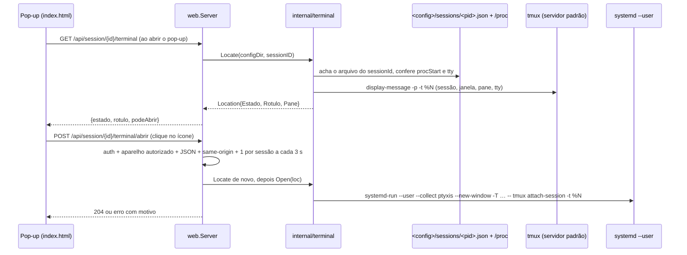

# focar-terminal Design

**Spec**: `.specs/features/focar-terminal/spec.md`
**Status**: Approved (2026-11-02)

---

## Architecture Overview

Nada muda no hook, no `ingest`, no `store` nem no SSE. A feature é um pacote novo que, sob demanda, liga o ID da sessão ao pane do tmux e abre uma janela do Ptyxis presa a ele, e duas rotas novas que o pop-up chama: uma para ler a localização ao abrir o pop-up e outra para abrir o terminal.



### Por que sob demanda e numa rota à parte

O pop-up refaz `GET /api/session/{id}` a cada `POLL_MS` enquanto está aberto. Pôr a localização ali rodaria o tmux a cada poll. A rota `/terminal` roda uma vez ao abrir o pop-up; o pane de uma sessão quase nunca muda enquanto o pop-up está aberto, e o `abrir` refaz a localização na hora de qualquer jeito.

### Por que uma janela nova

Teste de 2026-11-02: `systemd-run --user ptyxis --new-window -- tmux attach -t =<sessão>` abriu uma janela que apareceu **na frente do navegador** no GNOME/Wayland. Trazer uma janela ou aba existente para a frente não é possível no Wayland sem extensão. Trocar a sessão da última aba usada (desenho anterior) não tinha efeito quando a aba estava escondida.

### Por que `systemd-run --user`

O Ptyxis é uma `GApplication` de instância única. Se não houver Ptyxis rodando, o processo que o servidor lançasse viraria a instância principal, dentro do cgroup do serviço: reiniciar o claude-fleet fecharia todas as janelas do terminal. Com `systemd-run --user --collect`, o Ptyxis nasce numa unit transitória própria (`run-*.service`), herda o ambiente gráfico do gerenciador do usuário (`WAYLAND_DISPLAY`, `DBUS_SESSION_BUS_ADDRESS`), e a unit some sozinha quando a última janela fecha (confirmado no teste).

---

## Code Reuse Analysis

### Existing Components to Leverage

| Component | Location | How to Use |
| --- | --- | --- |
| `account.configDir` (dedução de `<dir>` a partir do transcript) | `internal/account/account.go` | Exportar como `account.ConfigDir(transcriptPath)` para achar `<dir>/sessions/` sem depender de `-account` |
| `Session.TranscriptPath` | `internal/store/types.go` | Já está no `store`; o `Store` ganha um getter estreito `TranscriptPath(id) (string, bool)` |
| `s.auth` | `internal/web/server.go` | As duas rotas novas passam pelo mesmo middleware de token/cookie |
| `crossSiteSubresource`, `remoteIsLoopback` | `internal/web/server.go` | Base do novo `focusAllowed` (L-005/L-006) |
| Padrão das flags com setter (`SetPush`, `SetUsage`) e de `-account` repetível | `cmd/claude-fleet/main.go`, `internal/web/server.go` | `-focus-from` é parseada no `main` e entregue por `SetTerminal(ips, terminal)` |
| Botões `.ocultar` em `.det-acoes` | `internal/web/static/index.html` | O ícone de terminal entra como mais um botão ali, mesmo tamanho e tokens |
| `icone()` e o mapa de ícones SVG | `internal/web/static/index.html` | Ícone `terminal` novo no mesmo formato |
| `det.aviso` / `.aviso` | `internal/web/static/index.html` | Aviso de resultado, sem componente novo |

### Integration Points

| System | Integration Method |
| --- | --- |
| Claude Code | Leitura de `<config>/sessions/*.json`, só `sessionId`, `procStart` e `tmux`; o resto do JSON é ignorado na decodificação |
| Linux `/proc` | `/proc/<pid>/stat`: campo 22 (`starttime`, comparado com `procStart`) e campo 7 (`tty_nr`) |
| tmux | `os/exec` do binário `tmux` no `PATH`, servidor padrão, só `display-message` |
| systemd + Ptyxis | `os/exec` de `systemd-run` com argumentos fixos, prazo de 5 s |

---

## Components

### `internal/terminal` (novo)

- **Purpose**: Dizer onde uma sessão do Claude roda no tmux e abrir uma janela de terminal presa a esse pane.
- **Location**: `internal/terminal/terminal.go`, `exec.go`, `terminal_test.go`, `testdata/`
- **Interfaces**:
  - `Locate(configDir, sessionID string) Location`: acha `<configDir>/sessions/<pid>.json` cujo `sessionId` bate (varre o diretório, só `*.json` de até 64 KiB), confere `procStart` com `/proc/<pid>/stat`, extrai `%N` do campo `tmux` (`^\d+:@\d+\.%\d+$`, só o `%N` é usado), roda `tmux display-message -p -t %N '#{session_name}\t#{window_index}\t#{pane_index}\t#{pane_tty}'` e confere que o `pane_tty` é o tty do PID (protege contra `%N` reaproveitado depois de reiniciar o servidor do tmux).
  - `Open(loc Location) error`: roda `systemd-run --user --quiet --collect --expand-environment=no ptyxis --new-window -T "claude-fleet · <rótulo>" -- tmux attach-session -t %N`. Com um ID de pane, o `attach-session` já seleciona a janela e o pane (T4); não há shell em nenhum ponto.
- **Dependencies**: um `Runner` (interface `Run(ctx, name string, args ...string) (string, error)`) e uma raiz de `/proc` injetáveis, para os testes não dependerem de tmux, systemd ou Ptyxis reais.
- **Lista fechada**: o `Runner` real só executa `tmux` com primeiro argumento `display-message` e `systemd-run` com a forma exata acima; qualquer outra chamada devolve erro, para a regra valer mesmo se outro código usar o pacote. Os únicos dados variáveis são o `%N` validado e o rótulo, montado da saída do próprio tmux e limpo de caracteres de controle.
- **Conferência do tty**: `tty_nr` do `/proc/<pid>/stat` contra o `st_rdev` do `pane_tty`. O `/proc/<pid>/fd/0` não serve: no serviço, o `PrivateTmp` cria um user namespace e o kernel nega a leitura (L-009).
- **Assinatura**: `Locate` e `Open` recebem o `context.Context` da requisição, com prazo próprio (2 s e 5 s).

### Rotas em `internal/web`

- `GET /api/session/{id}/terminal` (auth): `{ "estado": "tmux" | "fora" | "desconhecido", "rotulo": "tmux 6:1.0", "podeAbrir": bool }`. `podeAbrir` = estado `tmux` **e** `trustedPeer(r)`. 404 se a sessão não existe no `store`.
- `POST /api/session/{id}/terminal/abrir` (auth + `focusAllowed`): corpo `{}`; refaz o `Locate` na hora (não confia no que o pop-up viu). 204 em sucesso; 409 "sessão encerrada" quando o pane não bate mais; 429 quando a mesma sessão pediu há menos de 3 s (sem abrir nada); 502 "não consegui abrir o terminal" quando o `systemd-run` falha ou estoura o prazo (o motivo detalhado vai para o log, não para a resposta); 404 sessão desconhecida; 403 aparelho não autorizado.
- **`trustedPeer(r)`**: o IP de origem (`Unmap`) é loopback, é um IP das interfaces locais (`net.InterfaceAddrs`, lido por pedido; o serviço escuta no IP do Tailscale e o navegador do desktop chega com esse IP de origem) ou está no conjunto de `-focus-from`. Comparação exata de `netip.Addr`, sem faixa.
- **`focusAllowed(w, r)`**: `trustedPeer(r)` (403); `Content-Type: application/json` (415); `Sec-Fetch-Site: same-origin` (403; o navegador manda, `curl` não, o que é aceitável: a rota é para o navegador); `Origin` presente e com o mesmo host do `Host` (403).
- **Uma janela por sessão a cada 3 s**: mapa `sessionID → último pedido aceito` sob mutex, limpo ao passar do prazo.

### Flag `-focus-from` (`cmd/claude-fleet`)

- **Formato**: lista separada por vírgula, repetível (`-focus-from 100.64.0.7 -focus-from fd7a:115c::7`), parseada com `netip.ParseAddr`. Entrada que não é IP (nome, CIDR, item vazio) aborta a subida com erro que cita a entrada (FOCO-10).
- **Log de início**: `terminal liberado para: 100.64.0.7` (ou `só a própria máquina`), uma linha.
- **Onde configurar**: `CLAUDE_FLEET_ARGS` em `~/.config/claude-fleet/env`, que a unit já repassa; a unit não muda por causa da flag.
- **Entrega ao servidor**: `web.Server.SetTerminal(allowed []netip.Addr, t Terminal)`, onde `Terminal` é a interface com `Locate`/`Open` (o `main` passa o `internal/terminal` real; os testes passam um falso). Sem `SetTerminal`, as duas rotas respondem 404, como `pushOff` faz com o push.

### Frontend (`index.html`)

- Ao abrir o pop-up (`abrirDetalhe`), um `fetch` único a `/terminal`. A linha `det-sub` ganha a localização em texto (`tmux 6:1.0`, "fora do tmux", "local desconhecido"), em todo aparelho.
- Com `podeAbrir`, aparece em `.det-acoes`, antes de "Silenciar"/"Ocultar", o botão com ícone de terminal (`aria-label="Abrir terminal (tmux 6:1.0)"`, `title` igual). Clique → botão desabilitado → `POST .../abrir` → aviso "Terminal aberto: tmux 6:1.0" ou o motivo, sem fechar o pop-up → botão reabilitado.
- Pop-up aberto por mini-tile de subagente já é o pop-up da sessão-mãe: nada extra.
- Tokens de `:root`, alvo de toque ≥ `--toque-min`, sem animação nova.

---

## Data Models

```go
// internal/terminal
type Estado string // "tmux", "fora", "desconhecido"

type Location struct {
    Estado Estado
    Rotulo string // "tmux <sessão>:<janela>.<pane>"; vazio fora do estado tmux
    Pane   string // "%N", uso interno, fora da API
}
```

Nada é persistido; nada entra no `store`.

---

## Decisões

### Aparelho autorizado: a própria máquina e os IPs de `-focus-from`

O serviço escuta no IP do Tailscale (`deploy/claude-fleet.service`), não no loopback; o navegador do desktop chega com o IP do Tailscale da própria máquina como origem. A regra base é "IP de origem pertence a uma interface local": quem tem shell na máquina já pode abrir um terminal, então isso não abre nada novo.

O celular de acompanhamento entra por lista explícita de IPs (decisão do usuário, 2026-11-02). O IP do Tailscale identifica o aparelho porque o Tailscale autentica cada nó com a chave dele; tirar o aparelho da tailnet corta o acesso. A alternativa "qualquer aparelho com token" foi descartada: o token, que até aqui só permitia ver, passaria a abrir janelas no desktop em qualquer aparelho que o tivesse. Faixa CIDR fica de fora de propósito, para a lista não crescer sem querer.

Risco aceito: quem estiver com o celular autorizado destravado consegue abrir janelas de terminal no desktop, presas a panes onde o Claude roda. A janela dá acesso ao pane como se a pessoa estivesse no teclado: isso exige estar na frente do desktop, e quem está lá já tem o teclado.

### Serviço systemd

Teste em 2026-11-02: com `PrivateTmp=yes`, o processo do serviço está no mesmo namespace de montagem da sessão (`/proc/<pid>/ns/mnt` igual) e enxerga `/tmp/tmux-1000/default`. O `PrivateTmp` não tem efeito nessa unit de usuário neste Ubuntu, então a feature funciona sem mudar a unit. Para não quebrar onde ele valer, a unit ganha `BindPaths=-/tmp/tmux-%U` (o `-` ignora diretório ausente); testado com `systemd-run --user -p PrivateTmp=yes -p BindPaths=/tmp/tmux-1000`. O fato de o `PrivateTmp` não valer vira uma lição (L-009) no `STATE.md`.

### AD-010 (nova, no mesmo PR)

**Decision:** O painel ganha uma única ação sobre a máquina: abrir uma janela nova do Ptyxis presa ao pane do tmux de uma sessão, por um comando fixo (`systemd-run --user … tmux attach-session -t %N`), pedida do navegador da própria máquina ou de um aparelho listado em `-focus-from` (IP do Tailscale). Nunca envia tecla, nunca roda outro programa, nunca age na sessão do Claude.
**Reason:** Chegar ao terminal da sessão que tocou o alerta, com a janela na frente de tudo, inclusive pedindo pelo celular de acompanhamento.
**Trade-off:** Primeira exceção ao "somente leitura" da AD-003, limitada a dois comandos fixos; cada clique abre uma janela que o usuário fecha com `prefix + d`; um aparelho listado e destravado pode abrir janelas no desktop.
**Alternative:** Só mostrar a localização (sem ação); trocar a sessão da última aba usada (`switch-client`, sem efeito quando a aba está escondida); liberar para qualquer aparelho com token; trazer a janela existente (inviável no Wayland sem extensão).

---

## Testes

| Caso | Como |
| --- | --- |
| `TestLocateAchaPaneDaSessao`, `...ProcStartDiferenteDaDesconhecido`, `...SemCampoTmuxEhFora`, `...TtyNaoBateDaDesconhecido`, `...ArquivoGrandeIgnorado`, `...TmuxForaDoArDaDesconhecido` | `testdata/sessions/*.json` anonimizados, `/proc` falso em diretório temporário, `Runner` falso |
| `TestOpenMontaComandoFixo`, `...RotuloSemCaractereDeControle`, `...ErroDoSystemdRun` | `Runner` falso registrando nome e argumentos |
| `TestRunnerRecusaComandoForaDaLista` (`tmux kill-server`, `tmux send-keys`, `sh`) | chamada direta ao `Runner` real |
| `TestAbrirRecusaOutroAparelho`, `...AceitaIPDeFocusFrom`, `...SemSameOrigin`, `...SemJSON`, `...OriginDeOutroHost`, `...SegundoPedidoEm3sRecebe429`, `TestTerminalPodeAbrirSoAutorizado` | `httptest` com `RemoteAddr` variado (loopback, IP local, IP da lista, IPv4 mapeado em IPv6, IP fora), como os testes da L-005 |
| `TestFocusFromRecusaEntradaInvalida` (nome, CIDR, item vazio) e `...AceitaListaERepeticao` | parse da flag no `main` |
| Real | `bash hook/test.sh` inalterado; UAT no navegador (desktop e celular) com a janela surgindo na frente |
