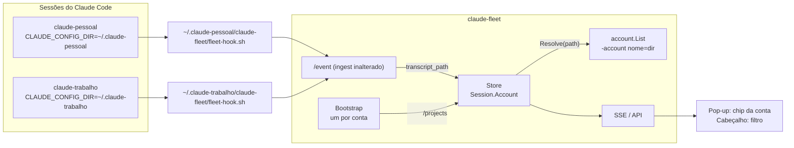

# multi-conta Design

**Spec**: `.specs/features/multi-conta/spec.md`
**Status**: Approved (2026-10-18)

---

## Architecture Overview

A conta é um rótulo calculado no servidor a partir do `transcript_path` (AD-009). O hook não muda, e o `ingest` continua com a mesma lista branca. Uma peça nova, `internal/account`, guarda as contas configuradas e resolve um caminho para o nome da conta. O Store chama essa resolução sempre que uma sessão recebe um `TranscriptPath`, venha ele de um evento ou do Bootstrap. A partir daí a conta viaja como qualquer outro campo do `SessionView` até a página.



O mesmo script de hook vale para todas as contas, mas o `install-hooks` grava uma cópia em cada diretório de configuração. Assim cada conta fica independente, e desinstalar de uma não quebra a outra.

---

## Code Reuse Analysis

### Existing Components to Leverage

| Component | Location | How to Use |
| --- | --- | --- |
| `parseHooksFlags` (`getenv` injetável) | `cmd/claude-fleet/install.go` | Ler `CLAUDE_CONFIG_DIR` pelo mesmo `getenv` que hoje lê `HOME`; os testes já injetam o ambiente |
| `parseConfig` | `cmd/claude-fleet/main.go` | `flag.Func` para o `-account` repetível; mesma validação de "argumento inválido sai com 2" |
| `Store.Bootstrap(projectsDir, …)` | `internal/store/bootstrap.go` | Sem mudar a assinatura: `main` chama uma vez por conta |
| `Store.Apply`, bloco `if ev.TranscriptPath != ""` | `internal/store/store.go:155` | Ponto único onde a conta é resolvida para eventos |
| `mutation.setString` | `internal/store/store.go` | Grava `Account` só quando muda, mantendo o sinal de "mudou" do SSE |
| Chave de ocultação `nome:` / cwd | `internal/web/static/index.html:923` | Prefixar com a conta quando houver (ver Tech Decisions) |
| Tokens de cor em `:root` | `internal/web/static/index.html:16-32` | Novos `--conta-1…4` no mesmo bloco, com versão clara se houver tema |

### Integration Points

| System | Integration Method |
| --- | --- |
| Hook (`fleet-hook.sh`) | Nenhuma mudança; `install-hooks` só muda o destino |
| `ingest` | Nenhuma mudança; `transcript_path` já é aceito |
| API (`/api/sessions`, `/api/session/{id}`, SSE) | Campo novo `Account` (string; vazio = sem conta para mostrar) |
| `uso-plano` (não implementada) | O design dela passa a usar `account.List.Resolve` sobre o `transcript_path` do JSON do status line e a guardar `map[conta]RateLimits` (CONTA-07) |
| `deploy/claude-fleet.service` | Comentário com exemplo de `-account`; a unit local do usuário recebe as flags |

---

## Components

### `internal/account` (novo)

- **Purpose**: Guardar as contas configuradas e dizer a qual conta pertence um caminho de transcript.
- **Location**: `internal/account/account.go`, `account_test.go`
- **Interfaces**:
  - `type Account struct { Name, Dir string }`: `Dir` absoluto e limpo.
  - `type List struct { … }`: contas ordenadas por `Dir` mais longo primeiro, mais o callback de conta desconhecida.
  - `Parse(specs []string, home string) (List, error)`: valida `nome=dir`, expande `~/` com `home`, exige caminho absoluto depois disso e recusa nome fora de `^[a-z0-9-]{1,20}$`, nome repetido, diretório repetido e o nome reservado `outra`.
  - ~~`Implicit(dir string) List`~~: removida na implementação (T4). Sem `-account`, o Store roda sem contas, `Resolve` numa `List` nil devolve `""` e a interface fica como hoje.
  - `(List) Resolve(transcriptPath string) string`: faz `filepath.Clean` e devolve a primeira conta cujo `<Dir>/projects/` é prefixo, ou `""` se a `List` for nil (sem `-account`). Fora de todas, devolve `"outra"` e chama `OnUnknown(configDir)` uma vez por diretório.
  - ~~`(List) ProjectsDirs() []string`~~: na implementação (T1) virou `(*List) All() []Account` + `(Account) ProjectsDir() string`, para o log levar o nome da conta junto.
  - `(*List) OnUnknown(func(configDir string))`: `main` liga ao `log`. O `configDir` é deduzido como o pai do segmento `projects`, nunca o caminho inteiro.
- **Dependencies**: só stdlib (`path/filepath`, `strings`, `sync`).
- **Reuses**: nada; é uma folha, como `pricing`.

### Store

- **Purpose**: Gravar a conta na sessão.
- **Location**: `internal/store/store.go`, `types.go`, `bootstrap.go`
- **Interfaces**:
  - `New(opts ...Option)` com `WithAccounts(account.List)`. Sem opção, `Resolve` é sempre `""`, então os testes atuais e o comportamento de hoje ficam intactos.
  - `Session.Account string` e `SessionView.Account string`. `SessionDetail` herda por embutir `Session`.
  - Em `Apply`, quando `ev.TranscriptPath != ""`: `m.setString(&sess.Account, s.accounts.Resolve(ev.TranscriptPath))`.
  - Em `Bootstrap`, ao criar a sessão: `Account: s.accounts.Resolve(d.path)`.
- **Dependencies**: `internal/account`.
- **Reuses**: `mutation.setString`, a criação de sessão em `Bootstrap`.
- **Subagentes**: herdam pela sessão-mãe; o `AgentView` não ganha campo, e a página lê a conta do tile.

### `cmd/claude-fleet` (servidor)

- **Purpose**: Flag `-account` e Bootstrap por conta.
- **Location**: `cmd/claude-fleet/main.go`
- **Interfaces**:
  - `config.Accounts []string` preenchido por `fs.Func("account", "conta do Claude Code: nome=diretório de configuração (repetível)", …)`.
  - `-projects` junto com `-account`: erro `"use só -account (o -projects vira <dir>/projects de cada conta)"`, saída 2.
  - Sem `-account`: Store sem `WithAccounts` e Bootstrap só em `cfg.Projects`, como hoje. Com `-account`: `account.Parse(accounts, HOME)`.
  - Laço `for _, a := range accounts.All() { st.Bootstrap(a.ProjectsDir(), …) }`, com log do total por conta.
- **Reuses**: `parseConfig`, `bootstrapMaxAge`.

### `cmd/claude-fleet` (`install-hooks` / `uninstall-hooks`)

- **Purpose**: Instalar na conta do `CLAUDE_CONFIG_DIR`.
- **Location**: `cmd/claude-fleet/install.go`
- **Interfaces**:
  - Base dos padrões: `getenv("CLAUDE_CONFIG_DIR")` se não vazio; senão, `$HOME/.claude`.
  - `CLAUDE_CONFIG_DIR` relativo ou começando com `~`: erro `"CLAUDE_CONFIG_DIR precisa ser absoluto (o shell não expandiu o ~?)"`, saída 2. Esse erro já aconteceu de fato: um `~` não expandido criou um diretório `./~/…` com credenciais dentro do repositório.
  - Antes da confirmação, mostrar `Conta: <dir>` acima do diff.
- **Reuses**: `parseHooksFlags`, `applyInstall`, `syncScript` sem mudança.

### Frontend (`internal/web/static/index.html`)

- **Purpose**: Mostrar a conta e filtrar por ela.
- **Interfaces / mudanças**:
  - **Chip da conta** (`chipConta`): mostra o texto do nome em vez de um ponto colorido, para não depender só de cor (CONTA-06). O fundo vem de `--conta-N`, e `N = hash(nome) % 4 + 1` dá a mesma cor em qualquer aparelho, sem configuração. Fica **só no pop-up**: a primeira versão também o punha em cada tile, e o ajuste de 2026-10-18 o tirou de lá (o filtro do cabeçalho já diz que conta está em vista). O tile cita a conta só no `aria-label`.
  - **Pop-up**: a conta entra no subtítulo (`detSub`, `index.html:1377`) antes do projeto.
  - **Ocultar sessão**: a chave vira `<conta>|nome:…` ou `<conta>|<cwd>` quando há conta. Sem conta, a chave fica igual, então nada que já está oculto reaparece.
  - **Filtro (P2)**: um `<select>` no cabeçalho, que só aparece quando os tiles têm mais de uma conta distinta. Fica salvo em `localStorage` (`fleet.conta`, com try/catch). Só esconde tiles; som e push seguem o estado real.
  - Celular: o tile fica como antes da feature; o seletor cabe no cabeçalho na vertical (no celular deitado o cabeçalho já ficava escondido; ver T8).
- **Figma**: chip, subtítulo e seletor entram no arquivo "claude-fleet — painel v2" pelo agente `ui-figma`, no mesmo PR.

---

## Data Models

```go
// internal/account
type Account struct {
	Name string // [a-z0-9-]{1,20}
	Dir  string // diretório de configuração, absoluto e limpo
}

// internal/store (campos novos)
type Session struct {
	// …
	Account string // nome da conta; "" sem -account
}
type SessionView struct {
	// …
	Account string
}
```

JSON exposto (sem tag, como os demais campos): `"Account": "trabalho"`. O diretório nunca sai do servidor.

Para o `uso-plano` (CONTA-07), `<state>/uso-plano.json` vira:

```json
{ "pessoal":  { "five_hour": {…}, "seven_day": {…}, "received_at": "…" },
  "trabalho": { … } }
```

com a chave `""` para quem roda sem `-account`. Um arquivo antigo, de valor único, é lido como `{"": valor}`.

---

## Error Handling Strategy

| Error Scenario | Handling | User Impact |
| --- | --- | --- |
| `-account` malformado, nome inválido, nome ou dir repetido | `parseConfig` devolve erro, saída 2 | Serviço não sobe; `journalctl` mostra a mensagem |
| `-account` e `-projects` juntos | Erro, saída 2 | Idem |
| `<dir>/projects` inexistente | `Bootstrap` já ignora diretório ilegível | Nenhum; a conta aparece quando houver sessão |
| Transcript fora de qualquer conta | `Resolve` → `"outra"`, log único com o diretório de configuração | Pop-up com chip "outra"; opção "outra" no filtro |
| Evento sem `transcript_path` | Conta não muda | Nenhum |
| `CLAUDE_CONFIG_DIR` relativo ou com `~` literal | `install-hooks` recusa, saída 2 | Mensagem aponta o `~` não expandido |
| `localStorage` indisponível | try/catch; filtro volta a "todas" | Filtro não lembrado |

---

## Tech Decisions

| Decision | Choice | Rationale |
| --- | --- | --- |
| Onde resolver a conta | No Store, ao receber `TranscriptPath` | Um ponto só para evento e Bootstrap; o `ingest` não muda (AD-003) |
| Sem `-account` | Store sem contas, `Account` vazio, sem chip | Quem tem uma conta só não vê nada novo (meta da spec); ver o desvio no T4 |
| Cor do chip | `hash(nome) % 4` sobre `--conta-1…4` | Estável entre aparelhos e recargas, sem nova flag de cor |
| `~` em `-account` | Expandido pelo servidor com `HOME` | O `sh -c` da unit systemd não expande `~` depois de `=` |
| Links simbólicos | `filepath.Clean`, sem `EvalSymlinks` | Evita um `stat` por evento; caso raro, documentado na spec |
| Pacote próprio `internal/account` | Sim, em vez de funções no `store` | Testável sozinho e reutilizado pelo `uso-plano` |
| Push | Título sem conta nesta feature | Spec não pede; vira ideia diferida se fizer falta |

---

## Test Plan

| Pacote | Teste (tabela de casos) |
| --- | --- |
| `account` | `TestParseRecusaNomeInvalido`, `TestParseExpandeTil`, `TestParseRecusaRepetido`, `TestResolvePrefixoMaisLongoVence`, `TestResolveForaDasContasViraOutraELogaUmaVez`, `TestResolveLimpaPontoPonto` |
| `store` | `TestApplyGravaContaPeloTranscript`, `TestApplySemTranscriptMantemConta`, `TestBootstrapMarcaContaPorDiretorio`, `TestSemContasNaoMudaNada` |
| `cmd/claude-fleet` | `TestParseConfigAccountComProjectsFalha`, `TestInstallHooksUsaClaudeConfigDir`, `TestInstallHooksRecusaConfigDirRelativo` |
| `hook/test.sh` | Caso novo: `CLAUDE_CONFIG_DIR=<tmp>` + `install-hooks -yes`, evento com `transcript_path` em `<tmp>/projects`, `/api/sessions` com `Account` certo |
| Navegador | Chip e filtro no desktop e em largura de celular (vertical e horizontal), com duas contas e com uma |
