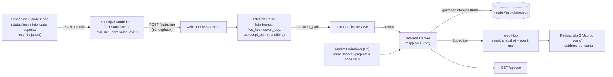

# uso-plano Design

**Spec**: `.specs/features/uso-plano/spec.md`
**Status**: Approved (2026-10-18)

---

## Architecture Overview

O uso do plano entra por um caminho paralelo ao dos hooks (AD-007). O status line de cada sessão chama `fleet-statusline.sh`, que repassa o JSON a `POST /statusline` no loopback. Um pacote novo, `internal/ratelimit`, decodifica só `rate_limits.five_hour` e `rate_limits.seven_day` (lista branca) e o `transcript_path`. Com o caminho, `account.List.Resolve` descobre a conta (AD-009), e o caminho é descartado em seguida. O `Tracker` guarda o último valor de cada conta, grava `<state>/uso-plano.json` e avisa os assinantes. O Hub do SSE, que hoje só manda `snapshot`, ganha um segundo tipo de evento, `uso`. A página troca de tela com um dedo entre a grade e os medidores.

O Store das sessões não muda: o uso do plano é por conta, não por sessão, e misturá-lo ao `Snapshot` faria o Notifier de push e o alerta sonoro reavaliarem a grade a cada mensagem do assistente.



---

## Code Reuse Analysis

### Existing Components to Leverage

| Component | Location | How to Use |
| --- | --- | --- |
| `fleet-hook.sh` + `hook.Script` (`embed`) | `hook/` | `fleet-statusline.sh` copia as regras e o cabeçalho; `hook.StatusLine` embute do mesmo jeito |
| `remoteIsLoopback`, padrão de `handleEvent` | `internal/web/server.go` | `handleStatusline` é o mesmo esqueleto: 403 fora do loopback, 400/413 sem citar o corpo, 204 |
| `ingest.Parse` (lista branca, `ErrTooLarge`) | `internal/ingest/event.go` | Mesmo padrão em `ratelimit.Parse`: `io.LimitReader` + decodificação num struct só com os campos aceitos |
| `account.List.Resolve` | `internal/account/account.go` | Conta pelo `transcript_path`; `List` nil devolve `""` (sem `-account`) |
| `writeFileAtomic` | `internal/push/vapid.go` | Vai para `internal/atomicfile` e passa a ser usado por `push` e `ratelimit` (ver Tech Decisions) |
| `Store.Subscribe` (canal com buffer 1, não bloqueia) | `internal/store/store.go` | `Tracker.Subscribe` segue o mesmo contrato, e o Hub o consome igual |
| `Hub.Run` / `broadcast` / `snapshotEvent` | `internal/web/sse.go` | Segundo canal no `select` e `usoEvent()`; o envio no conectar passa a mandar os dois eventos |
| `applyInstall` / `applyUninstall`, `parseObject`, `renderObject`, `sameJSON`, `syncScript`, diff e backup | `cmd/claude-fleet/install.go` | O `statusLine` é mais um membro do objeto de topo; o mesmo diff, confirmação e backup cobrem tudo |
| `transcript.File` (leitura incremental, dedupe por `message.id`, L-001) | `internal/transcript/reader.go` | P2: cada chamada passa a guardar o timestamp; `SumSince(t)` soma por modelo a partir de `t` |
| `pricing.Cost` | `internal/pricing/pricing.go` | P2: custo das janelas, rotulado como estimativa (AD-005) |
| Tokens de `:root`, `localStorage` com try/catch, `@media (prefers-reduced-motion)` | `internal/web/static/index.html` | Novos tokens `--uso-*`; tela lembrada em `fleet.tela`; troca sem animação com movimento reduzido |

### Integration Points

| System | Integration Method |
| --- | --- |
| Claude Code (`statusLine`) | `install-hooks` grava `{"type": "command", "command": "<dir>/fleet-statusline.sh"}` no `settings.json` da conta, ao lado dos hooks |
| Hook e `ingest` | Nenhuma mudança |
| Store e Notifier de push | Nenhuma mudança |
| SSE `/stream` | Evento novo `uso`; o `snapshot` continua igual, e a página atual ignora o evento desconhecido |
| API | `GET /api/uso` (com token), para o teste independente e para a página buscar no carregamento |
| `main` | Cria o `Tracker` com `cfg.StateDir` e `cfg.Accounts`, passa ao Hub e ao Server; P2 liga o `Windows` |

---

## Components

### `hook/fleet-statusline.sh` (novo)

- **Purpose**: Repassar o JSON do status line ao servidor sem afetar o Claude Code.
- **Location**: `hook/fleet-statusline.sh`, `hook/embed.go` (`var StatusLine string`)
- **Comportamento**: o mesmo do `fleet-hook.sh` (porta `CLAUDE_FLEET_PORT` só com dígitos, `command -v curl`, `[ -t 0 ]`, `curl -q -s -m 1 --noproxy '*' --data-binary @-`), trocando a rota para `/statusline`. Não imprime nada e sempre sai com 0 (USO-01, AD-006).
- **Reuses**: o texto do `fleet-hook.sh`. Os dois scripts ficam separados, sem `$1` para escolher a rota, porque o `isFleetGroup` reconhece os hooks pelo nome do arquivo, e assim cada script tem um só papel.

### `internal/ratelimit` (novo)

- **Purpose**: Lista branca do JSON do status line, último valor por conta, persistência e aviso de mudança.
- **Location**: `internal/ratelimit/ratelimit.go`, `tracker.go`, `ratelimit_test.go`, `tracker_test.go`, `testdata/`
- **Interfaces**:
  - `Parse(r io.Reader, max int64) (Reading, error)`: decodifica só `rate_limits.five_hour`, `rate_limits.seven_day` e `transcript_path`. Uma janela com `used_percentage` fora de `[0, 100]` ou `resets_at <= 0` é descartada como ausente. `ErrTooLarge` acima de `max` (64 KiB).
  - `type Reading struct { TranscriptPath string; FiveHour, SevenDay *Window }`. O `TranscriptPath` só vive até o `Resolve`; não tem tag JSON, não é gravado nem logado.
  - `Load(path string, names []string, now func() time.Time) (*Tracker, error)`: lê o arquivo (ausente = vazio; formato antigo de valor único vira a conta `""`) e cria uma entrada vazia para cada conta declarada, para a tela mostrar "sem dado" nelas. `path` vazio: só memória.
  - `(t *Tracker) Apply(conta string, r Reading) (changed bool)`: cada janela presente substitui a anterior; janela ausente mantém a anterior (o Claude Code tira a janela do JSON quando o `resets_at` dela passa, e a tela trata isso como "reiniciada"). `ReceivedAt = now()` sempre que veio ao menos uma janela. JSON sem nenhuma janela não muda nada (chave de API, Bedrock).
  - `(t *Tracker) Snapshot() []Entry`: cópia ordenada por nome de conta.
  - `(t *Tracker) Subscribe() <-chan struct{}`: mesmo contrato do `Store.Subscribe`.
  - `(t *Tracker) SetWindows(conta string, w WindowTotals)` (P2).
- **Quando avisar e gravar**: o status line roda a cada resposta do assistente, então avisar e gravar a cada chamada seria barulho. O `Tracker` avisa e grava quando um percentual ou um `resets_at` muda, ou quando o último aviso tem mais de `staleAfter = 1 min`. Assim o "atualizado há" fica certo com resolução de minuto, com no máximo uma escrita por minuto em uso contínuo (USO-04).
- **Conta**: o handler resolve a conta antes de chamar `Apply`. Com `-account`, `"outra"` e caminho vazio são descartados (não há conta a que atribuir o valor). Sem `-account`, tudo vai para `""`.
- **Dependencies**: `internal/atomicfile`, stdlib.

### `internal/atomicfile` (novo, extraído)

- **Purpose**: `Write(path string, data []byte, perm fs.FileMode) error` via temporário + `rename`.
- **Reuses**: o corpo de `push.writeFileAtomic`, que passa a chamar este. O `writeAtomic` do `install.go` preserva o modo do arquivo original do `settings.json` e fica onde está.

### `internal/web`

- **Server**: `SetUsage(u Usage, accounts *account.List)`; rota `POST /statusline` fora do `auth`, como o `/event`, e `GET /api/uso` dentro dele. Sem `SetUsage`, `/statusline` responde 204 e descarta, para o script nunca ver erro.
  - `type Usage interface { Apply(string, ratelimit.Reading) bool; Snapshot() []ratelimit.Entry; Subscribe() <-chan struct{} }`
  - `handleStatusline`: loopback → `ratelimit.Parse(r.Body, MaxStatuslineBytes)` → `Resolve` → `Apply` → 204. Recusas contam em `statuslineErrors`, como `eventErrors`, sem guardar o corpo.
- **Hub**: `NewHub(src Source, opts ...HubOption)` com `WithUsage(UsageSource)`. O `Run` passa a escutar os dois canais; uma mudança de uso agenda o envio de `event: uso` com a mesma janela de `Coalesce`, sem mandar um `snapshot` junto. Ao conectar, o cliente recebe `snapshot` e depois `uso`. Sem a opção, o Hub fica como hoje (os testes atuais seguem valendo).

### `cmd/claude-fleet`

- **Servidor (`main.go`)**: `ratelimit.Load(filepath.Join(cfg.StateDir, "uso-plano.json"), nomes das contas, time.Now)`. Erro de leitura vira log e `Tracker` só em memória (edge case da spec). Nomes: `cfg.Accounts.All()`; sem `-account`, `[""]`.
- **Instalador (`install.go`)**:
  - `install-hooks` grava também `<dir>/fleet-statusline.sh` (0755, `syncScript`) e aplica `applyStatusLine(top, command)` depois dos hooks:
    - sem `statusLine`: acrescenta `{"type": "command", "command": "<dir>/fleet-statusline.sh"}`;
    - `statusLine` do Fleet (comando terminando em `/fleet-statusline.sh`) diferente do desejado: troca;
    - `statusLine` alheio: não toca e avisa `"<settings> já tem um statusLine (<comando>); o uso do plano fica sem fonte. Veja features/uso-plano."`. Os hooks são instalados mesmo assim, e o código de saída é 0.
  - `uninstall-hooks` remove o `statusLine` só se for do Fleet, e lembra de apagar o script à mão, como faz com o hook.
  - O diff mostrado antes da confirmação já inclui a mudança, porque é o mesmo `settings.json`.
  - A mensagem final cita o efeito colateral (ver Tech Decisions): `"statusLine do claude-fleet registrado; ele não imprime nada, e o Claude Code esconde as dicas do rodapé enquanto houver um statusLine."`

### Frontend (`internal/web/static/index.html`)

- **Estrutura**: `<main>` vira `<div id="telas">` com `<section id="tela-sessoes">` (grade, vazio, nota) e `<section id="tela-uso">`. Embaixo, `<nav id="pontos">` com dois botões (`aria-label` "Sessões" / "Uso do plano", `aria-current` na atual). O cabeçalho fica igual e vale para as duas telas.
- **Troca de tela (USO-06)**:
  - Ponteiro: `pointerdown/move/up` em `#telas` com `touch-action: pan-y`, para o navegador continuar rolando na vertical sozinho (USO-08, critério 7). Troca quando `|dx| ≥ 60 px` e `|dx| > 2·|dy|`; não troca com o pop-up aberto nem em toque que começou num `<select>`.
  - Teclado: `←`/`→` no `document`, ignorados com o pop-up aberto ou com o foco num campo de formulário. O Enter/Espaço da grade não muda.
  - Animação: `transform: translateX(-100%)` com `transition: .25s`; em `prefers-reduced-motion`, sem transição.
  - Tela lembrada em `localStorage` (`fleet.tela`, try/catch). Na tela de uso, a outra seção recebe `inert`, para o leitor de tela e o Tab não entrarem nela.
- **Tela de uso (USO-07)**:
  - Um bloco por conta (`Snapshot`). Com uma conta só, sem nome; com mais de uma, o título é o chip da conta (`chipConta`, já existente).
  - Cada bloco tem dois medidores, **Sessão (5 h)** e **Semana**: barra horizontal com `role="meter"` (`aria-valuenow`), percentual em número grande (`tabular-nums`), "reinicia às 14:30 · em 2 h 14 min" e, no bloco, "atualizado há 3 min".
  - Estados: sem dado ("sem dado do plano ainda — abra uma sessão do Claude Code"); `resets_at` no passado ("reiniciada, aguardando dado novo", barra vazia e apagada); dado com mais de 1 h ganha o texto "atualizado há" em `--muted` para reforçar que pode estar velho.
  - Relógio de 30 s recalcula as contagens só com a tela de uso visível.
  - Tokens novos em `:root`: `--uso-trilho`, `--uso-ok` (= `--ativo`), `--uso-alerta` (≥ 80%, = `--aguardando`), `--uso-critico` (≥ 95%, vermelho novo com contraste AA sobre `--surface`). O percentual vai sempre em texto, então a cor não é a única pista.
  - Dados: `GET /api/uso` no carregamento e `es.addEventListener('uso', …)` depois.
- **Figma**: a tela de uso, os pontinhos e os tokens novos entram no "claude-fleet — painel v2" pelo agente `ui-figma`, no mesmo PR.

### P2: janelas de tokens e custo (`ratelimit.Windows`)

- **Purpose**: Somar tokens e custo das últimas 5 h e 7 dias, por conta, a partir dos transcripts (USO-09).
- **Location**: `internal/ratelimit/windows.go`; mudança pequena em `internal/transcript/reader.go`.
- **Interfaces**:
  - `transcript.File`: `call` ganha `ts time.Time` (o `timestamp` da linha do assistente). Método novo `SumSince(t time.Time) map[ModelKey]Tokens`, que percorre o `calls` já deduplicado (L-001).
  - `NewWindows(dirs map[string]string, tr *Tracker)` com `Run(ctx, 30*time.Second)`: a cada volta, `filepath.WalkDir` em `<conta>/projects` atrás de `*.jsonl` (inclui `subagents/`) com `mtime` nos últimos 7 dias. Cada arquivo tem um `transcript.File` próprio, mantido entre voltas, e quem sai da janela é descartado. O início da janela de 5 h é `five_hour.resets_at − 5 h` quando há dado do plano e ele não venceu; senão, `now − 5 h`.
  - Resultado `WindowTotals{FiveHour, SevenDay struct{ Tokens pricing.Tokens; CostUSD float64; CostKnown bool }}` vai para `Tracker.SetWindows`, que avisa só se mudou.
- **Por que separado do `Refresher`**: o `Refresher` lê só as sessões vivas a cada 5 s. As janelas precisam de transcripts de sessões já encerradas e mudam devagar.
- **Tela**: abaixo dos medidores, uma linha por janela com "entrada · cache · saída" e o custo com o rótulo de estimativa.

---

## Data Models

```go
// internal/ratelimit
type Window struct {
	UsedPercentage float64 `json:"used_percentage"` // 0–100; o Claude Code manda com casa decimal (ex.: 23.5)
	ResetsAt       int64   `json:"resets_at"`       // segundos Unix
}

type Entry struct {
	Account    string        `json:"account"`               // "" sem -account
	FiveHour   *Window       `json:"five_hour,omitempty"`
	SevenDay   *Window       `json:"seven_day,omitempty"`
	ReceivedAt time.Time     `json:"received_at,omitzero"`  // zero: nunca chegou dado
	Windows    *WindowTotals `json:"windows,omitempty"`     // P2
}
```

`<state>/uso-plano.json` (0600), o mapa que o multi-conta fixou:

```json
{
  "pessoal":  { "five_hour": { "used_percentage": 37, "resets_at": 1792171200 },
                "seven_day": { "used_percentage": 12, "resets_at": 1792603200 },
                "received_at": "2026-10-18T14:02:11-03:00" },
  "trabalho": { "seven_day": { "used_percentage": 64.5, "resets_at": 1792603200 },
                "received_at": "2026-10-18T13:40:02-03:00" }
}
```

O formato antigo (um objeto com `five_hour` no topo) é lido como `{"": objeto}`. As janelas do P2 não são gravadas: são recalculadas dos transcripts ao subir.

API e SSE (`GET /api/uso` e `event: uso`): `[]Entry` em JSON, ordenado por conta, lista vazia como `[]`. Nenhum caminho, `session_id`, `cwd`, modelo ou custo do Claude Code sai do servidor (USO-02).

---

## Error Handling Strategy

| Error Scenario | Handling | User Impact |
| --- | --- | --- |
| `POST /statusline` de fora do loopback | 403 | Nenhum |
| Corpo acima de 64 KiB ou JSON inválido | 413/400 sem citar o corpo; conta em `statuslineErrors` | Nenhum; o script ignora a resposta |
| JSON sem `rate_limits` (chave de API, Bedrock, antes da 1ª resposta) | `Apply` não muda nada | Tela mantém o último valor |
| Uma janela ausente | Mantém a anterior | Se o `resets_at` passou, "reiniciada, aguardando dado novo" |
| Valor fora de `[0, 100]` ou `resets_at` inválido | Janela descartada como ausente | Idem |
| Transcript de conta não declarada (`outra`) ou sem caminho com `-account` | Descartado; o `OnUnknown` já loga o diretório uma vez | A conta não aparece na tela de uso |
| `uso-plano.json` ilegível ou corrompido | Log, começa vazio, segue só em memória | "sem dado" até a próxima resposta |
| Falha ao gravar | Log (no máximo uma vez por minuto), segue em memória | Nenhum até reiniciar o serviço |
| Servidor fora | `curl -m 1` desiste, exit 0 | Status line em branco, como já é |
| `statusLine` alheio no `settings.json` | `install-hooks` não toca e avisa | Tela de uso mostra "sem dado" |
| `localStorage` indisponível | try/catch | Abre sempre na grade |

---

## Tech Decisions

| Decision | Choice | Rationale |
| --- | --- | --- |
| Onde guardar o uso | `ratelimit.Tracker`, fora do Store | Por conta, não por sessão; não acorda Notifier nem som a cada resposta |
| Transporte para a página | Evento SSE `uso` no Hub existente | Uma conexão só; o `snapshot` e seus testes não mudam |
| Frequência de aviso e gravação | Mudança de valor, ou 1 min desde o último aviso | Status line roda a cada resposta; "atualizado há" tem resolução de minuto |
| Janela ausente no JSON | Mantém a última | A doc do Claude Code diz que a janela some quando o `resets_at` passa; a spec pede "reiniciada" e não "sem dado" |
| `used_percentage` | `float64` | A doc mostra valores como `23.5`; a página arredonda para inteiro |
| `spend_limit` | Ignorado | Só existe atrás de gateway; fora do escopo e fora da lista branca |
| Dois scripts em vez de um com argumento | `fleet-statusline.sh` separado | O instalador reconhece cada papel pelo nome do arquivo |
| `writeFileAtomic` | Extraído para `internal/atomicfile` | Seria a terceira cópia; o do instalador continua próprio porque preserva o modo do `settings.json` |
| `refreshInterval` no `statusLine` | Não usar | O `rate_limits` só muda com resposta da API; o timer só reenviaria o mesmo dado |
| Rodapé do Claude Code | Aceitar e avisar no `install-hooks` | Com qualquer `statusLine`, o Claude Code esconde dicas como `esc to interrupt` e `? for shortcuts` (doc oficial). O script não imprime nada (spec) |
| Gesto | Pointer Events com `touch-action: pan-y` | Sem biblioteca; o navegador cuida da rolagem vertical e só o horizontal chega ao JS |
| P2 numa goroutine própria a cada 30 s | `ratelimit.Windows` | Precisa de transcripts de sessões encerradas; o `Refresher` só olha as vivas |

---

## Test Plan

| Pacote | Teste (tabela de casos) |
| --- | --- |
| `ratelimit` | `TestParseGuardaSoRateLimits` (fixture real anonimizada em `testdata/`, confere que nada além das janelas sobrevive), `TestParseDescartaJanelaInvalida`, `TestParseRecusaCorpoGrande`, `TestApplyJanelaAusenteMantemAnterior`, `TestApplySemJanelaNaoMuda`, `TestApplyAvisaSoNaMudancaOuDepoisDeUmMinuto`, `TestLoadFormatoAntigoViraContaImplicita`, `TestLoadArquivoCorrompidoComecaVazio`, `TestGravaComPermissao600`, `TestContasDeclaradasNascemSemDado` |
| `atomicfile` | `TestWriteNaoDeixaTemporario`, `TestWriteUsaPermissao` |
| `web` | `TestStatuslineSoDoLoopback`, `TestStatuslineResolveConta` (com `-account`: conta certa, `outra` descartada), `TestStatuslineSemUsageResponde204`, `TestApiUsoExigeToken`, `TestHubEnviaUsoAoConectar`, `TestHubMudancaDeUsoNaoReenviaSnapshot` |
| `cmd/claude-fleet` | `TestInstallHooksRegistraStatusLine`, `TestInstallHooksNaoSobrescreveStatusLineAlheio`, `TestInstallHooksTrocaStatusLineAntigoDoFleet`, `TestUninstallHooksRemoveSoStatusLineDoFleet`, `TestInstallHooksGravaOsDoisScripts` |
| `transcript` (P2) | `TestSumSinceRespeitaTimestampEDedupe` |
| `ratelimit` (P2) | `TestWindowsSomaContraContagemManual` (diretório de fixtures), `TestWindowsUsaInicioDaJanelaDoPlano` |
| `hook/test.sh` | Casos novos: `fleet-statusline.sh` com o servidor fora termina em ≤ 1 s, sem stdout/stderr, exit 0; com o servidor de pé, `/api/uso` mostra o valor e o arquivo não tem `transcript_path` |
| Navegador | Arrasto e pontinhos no celular (vertical e horizontal), setas no desktop, rolagem vertical da grade, movimento reduzido, uma conta e duas contas, sem dado e reiniciada |
