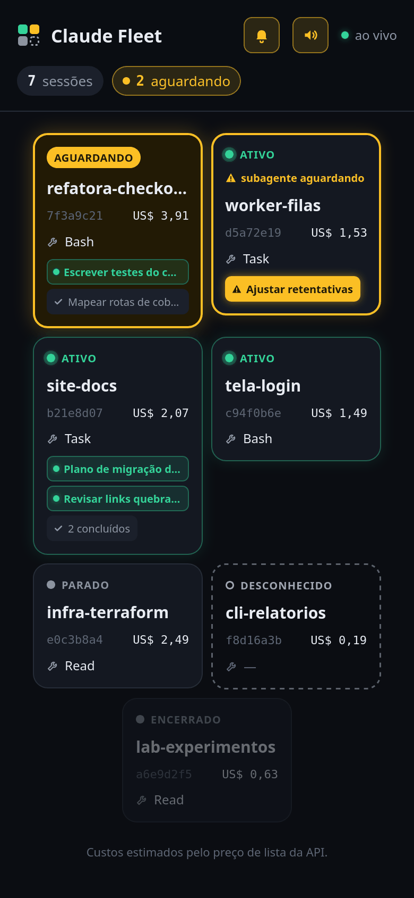
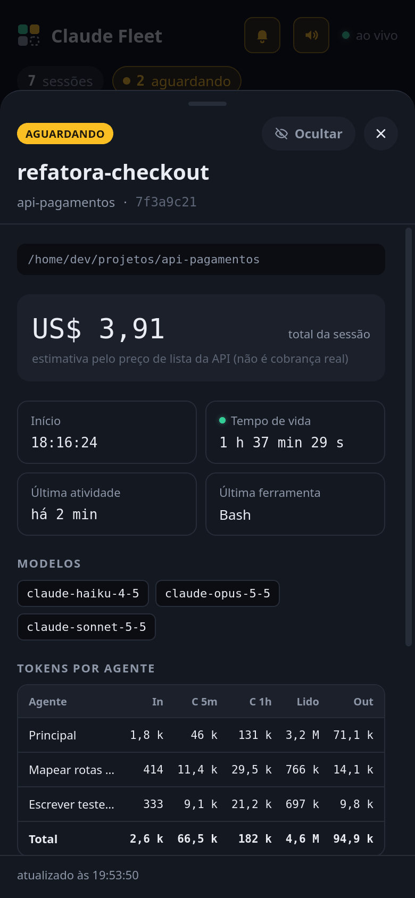
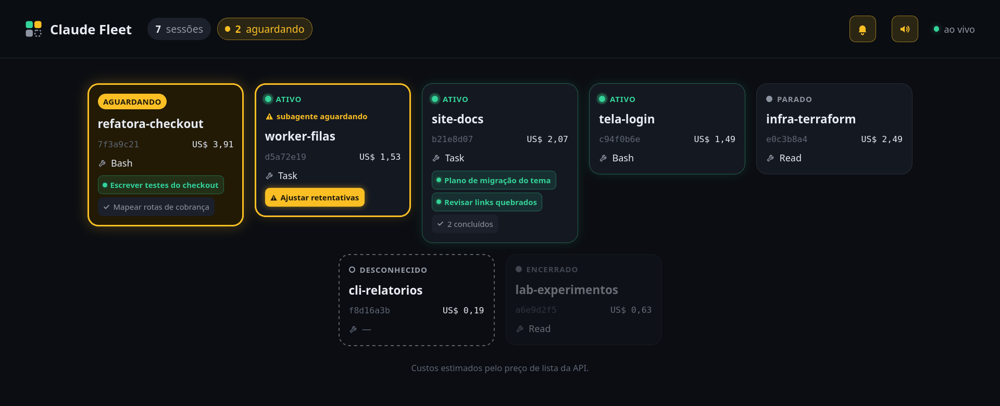

<p align="center">
  
</p>

<h1 align="center">claude-fleet</h1>

Painel web, feito para o celular, que mostra ao vivo as sessões do Claude Code rodando nesta máquina e os subagentes de cada uma. Cada sessão é um quadradinho que pulsa enquanto trabalha e fica amarelo quando espera permissão. Um toque abre os detalhes: tempo de vida, tokens por categoria e custo estimado.

<p align="center">
  
  &nbsp;&nbsp;
  
</p>

<p align="center">
  
</p>

<p align="center"><sub>Telas do painel com dados fictícios.</sub></p>

- **Somente leitura:** o painel não envia prompts, não aprova permissões e não encerra nada.
- **Sem conteúdo:** os hooks repassam o evento inteiro, mas o servidor guarda só metadados (nome do evento, ferramenta, status, ids). Prompts, comandos e respostas são descartados ao chegar.
- **Um binário só**, sem banco e sem dependências; o estado fica em memória e os tokens são relidos dos transcripts em `~/.claude/projects/`.

> **Custo é estimativa.** O valor em US$ é calculado pelo preço de lista da API. Em plano de assinatura ele não corresponde à fatura; serve para comparar sessões entre si.

## Requisitos

- Linux, Go 1.27.2 ou mais novo (o mínimo sobe a cada CVE da stdlib, AD-008), `curl`.
- Claude Code com hooks (testado na 2.1.301).
- Para o celular: [Tailscale](https://tailscale.com) na máquina e no celular, na mesma tailnet.

## 1. Compilar

```sh
git clone https://github.com/devpolatto/claude-fleet.git
cd claude-fleet
go build -o ~/.local/bin/claude-fleet ./cmd/claude-fleet
```

## 2. Instalar os hooks

O instalador grava o script do hook em `~/.claude/claude-fleet/fleet-hook.sh` e acrescenta uma entrada em 16 eventos do `~/.claude/settings.json`, ao lado dos hooks que já existem. Antes de gravar, ele mostra o diff, pede confirmação e faz um backup datado (`settings.json.bak-AAAAMMDD-HHMMSS`).

```sh
claude-fleet install-hooks
```

- Rodar de novo não duplica nada ("nada a fazer").
- Para remover: `claude-fleet uninstall-hooks`. Só as entradas do claude-fleet saem; o script em `~/.claude/claude-fleet/` fica, e pode ser apagado à mão.
- Opções: `-settings <arquivo>` (outro settings), `-dir <diretório>` (onde gravar o script) e `-yes` (sem confirmação).
- Sessões do Claude Code já abertas podem só enxergar os hooks novos depois de abrir `/hooks` ou reiniciar.

<details>
<summary>Instalação manual</summary>

Copie `hook/fleet-hook.sh` para um lugar fixo, dê `chmod 755` e acrescente, em cada evento abaixo dentro de `"hooks"` no `settings.json`, um grupo com o caminho absoluto do script:

```json
{"hooks": [{"type": "command", "command": "/home/voce/.claude/claude-fleet/fleet-hook.sh", "timeout": 5}]}
```

Eventos: `SessionStart`, `SessionEnd`, `UserPromptSubmit`, `PreToolUse`, `PostToolUse`, `PostToolUseFailure`, `PostToolBatch`, `PermissionRequest`, `PermissionDenied`, `Notification`, `Stop`, `StopFailure`, `SubagentStart`, `SubagentStop`, `PreCompact`, `PostCompact`. Não use `matcher` nem `async`: o hook é síncrono de propósito, porque um envio em segundo plano pode se perder quando a sessão termina.

</details>

O hook manda o JSON do evento para `http://127.0.0.1:7777/event` com `curl -m 1` e sempre termina com sucesso, sem escrever nada na saída. Com o servidor fora do ar, ele volta na hora; o pior caso é 1 s, com um servidor travado. Se o servidor usar outra porta, defina `CLAUDE_FLEET_PORT` no ambiente do Claude Code (por exemplo, no bloco `"env"` do `settings.json`).

## 3. Rodar localmente

```sh
claude-fleet
```

Abra <http://127.0.0.1:7777>. Sem flags o servidor escuta só em `127.0.0.1:7777` e não pede token. Ao subir, ele também mostra as sessões cujo transcript mudou nos últimos 30 minutos, como "desconhecido" até o próximo evento delas.

| Flag | Padrão | Uso |
| --- | --- | --- |
| `-addr` | `127.0.0.1:7777` | Endereço de escuta (`host:porta`). |
| `-token` | `$CLAUDE_FLEET_TOKEN` | Obrigatório quando o endereço não é loopback. |
| `-projects` | `~/.claude/projects` | Onde ficam os transcripts. |

Um endereço fora do loopback sem token é recusado: o processo sai com código 2.

## 4. Acessar pelo celular (Tailscale)

1. Gere um token e guarde-o num arquivo só seu:

   ```sh
   mkdir -p ~/.config/claude-fleet
   printf 'CLAUDE_FLEET_TOKEN=%s\n' "$(head -c 32 /dev/urandom | base64 | tr -d '/+=')" > ~/.config/claude-fleet/env
   chmod 600 ~/.config/claude-fleet/env
   ```

2. Suba o servidor no IP da máquina na tailnet:

   ```sh
   set -a; . ~/.config/claude-fleet/env; set +a
   claude-fleet -addr "$(tailscale ip -4):7777"
   ```

   Com um IP específico, o servidor também escuta em `127.0.0.1:7777`, para o hook continuar entregando os eventos.

3. No celular, conectado à tailnet, abra uma vez `http://<IP da tailnet>:7777/?t=<token>`. A página grava um cookie (`HttpOnly`, `SameSite=Lax`, 30 dias desde o último uso) e redireciona para `/`, tirando o token da barra e do histórico; daí em diante, basta `http://<IP da tailnet>:7777/`. Sem cookie, a página mostra uma tela para colar o token, que grava o mesmo cookie.

Como fica protegido:

- `POST /event` só aceita conexões vindas da própria máquina; pela tailnet ele responde 403.
- As outras rotas exigem o token (cookie, `?t=` ou a tela de login), comparado em tempo constante.
- O tráfego é cifrado pelo Tailscale (WireGuard). Com HTTPS (abaixo), o painel também é, e o cookie ganha `Secure`.

> **Não use `tailscale serve` na frente do painel.** Ele faz proxy a partir da própria máquina, então toda requisição chega como loopback, e o `/event` passaria a aceitar eventos falsos vindos da tailnet. Use o bind direto no IP da tailnet, como acima. Também não exponha a porta na internet.

### HTTPS e instalação como app

O navegador só instala o painel como app (ícone na tela inicial do celular e no GNOME, janela própria) quando ele é servido por HTTPS. O certificado vem do próprio Tailscale e vale para o nome da máquina na tailnet.

1. No painel de administração do Tailscale, em **DNS**, habilite MagicDNS e **HTTPS Certificates**.
2. Deixe seu usuário gerar certificados sem `sudo` (uma vez só):

   ```sh
   sudo tailscale set --operator=$USER
   ```

3. Grave o nome da máquina no `env` e gere o certificado:

   ```sh
   dominio=$(tailscale status --json | jq -r '.Self.DNSName | rtrimstr(".")')   # ex.: meu-pc.tail1234.ts.net
   printf 'CLAUDE_FLEET_TLS_DOMAIN=%s\n' "$dominio" >> ~/.config/claude-fleet/env
   tailscale cert --cert-file ~/.config/claude-fleet/tls.crt --key-file ~/.config/claude-fleet/tls.key "$dominio"
   ```

4. Suba com os dois flags. Só o IP da tailnet vira HTTPS; o `127.0.0.1:7777` do hook continua em HTTP:

   ```sh
   claude-fleet -addr "$(tailscale ip -4):7777" \
     -tls-cert ~/.config/claude-fleet/tls.crt -tls-key ~/.config/claude-fleet/tls.key
   ```

5. No navegador, abra uma vez `https://<nome>.ts.net:7777/?t=<token>` (sempre pelo **nome**: pelo IP o certificado não vale). Com o cookie gravado, instale pelo menu do navegador ("Instalar app" no Chrome do Android; ícone de instalar na barra de endereço no Chrome/Brave do desktop). O app usa o mesmo cookie, renovado a cada abertura; se ele faltar ou vencer (30 dias sem uso), o próprio app mostra a tela de login.

Se o celular disser que não encontrou o endereço (`*.ts.net`) mas o desktop abre, desligue o **DNS seguro** do Chrome (Configurações → Privacidade e segurança → Usar DNS seguro → "Usar o provedor atual"): com um provedor escolhido, o Chrome resolve os nomes por fora e não enxerga o MagicDNS. O **DNS privado** do Android com um nome de servidor fixo causa o mesmo efeito.

`-tls-cert` e `-tls-key` vão juntos e exigem `-addr` num IP específico fora do loopback; nos outros casos o processo sai com erro. O certificado do Tailscale vale 90 dias: o timer da seção 5 o renova, e o painel relê os arquivos sozinho, sem reiniciar.

### Notificações push

Com o painel em HTTPS, o sino do cabeçalho (ao lado do botão de som) liga as notificações **neste aparelho**: o navegador pede permissão e o aparelho se inscreve no servidor. Daí em diante, quando uma sessão ou um subagente entra em "aguardando", o servidor manda uma notificação a todos os aparelhos inscritos, mesmo com o app fechado e a tela bloqueada, e repete a cada 5 min enquanto ela seguir aguardando. A notificação diz só o nome da sessão; tocar nela abre o painel.

- O servidor guarda a chave VAPID (`vapid.pem`) e as inscrições (`push-subscriptions.json`) em `~/.config/claude-fleet/` (flag `-state-dir`), com permissão 600. Apagar o `vapid.pem` invalida todas as inscrições.
- O envio sai do servidor para o serviço de push do navegador (no Chrome, `fcm.googleapis.com`), com o conteúdo cifrado de ponta a ponta (RFC 8291): o serviço não lê a mensagem.
- Para testar sem esperar uma sessão: `curl -X POST -b "fleet_token=<token>" https://<nome>.ts.net:7777/api/push/test`.
- Se o diretório de estado não puder ser usado, só o push fica desligado (o sino não aparece) e o painel sobe normalmente.

## 5. Deixar sempre de pé (systemd de usuário)

O arquivo [`deploy/claude-fleet.service`](deploy/claude-fleet.service) sobe o painel em HTTPS no IP da tailnet, com o token de `~/.config/claude-fleet/env` e o certificado da seção anterior. O [`claude-fleet-cert.timer`](deploy/claude-fleet-cert.timer) roda [`claude-fleet-cert.service`](deploy/claude-fleet-cert.service) toda semana para renovar o certificado.

```sh
mkdir -p ~/.config/systemd/user
cp deploy/claude-fleet.service deploy/claude-fleet-cert.service deploy/claude-fleet-cert.timer ~/.config/systemd/user/
systemctl --user daemon-reload
systemctl --user enable --now claude-fleet claude-fleet-cert.timer
journalctl --user -u claude-fleet -f   # logs
```

Sem HTTPS ainda? Tire os dois flags `-tls-*` do `ExecStart` da cópia em `~/.config/systemd/user/` e não habilite o timer.

Para o serviço continuar rodando sem sessão aberta: `sudo loginctl enable-linger "$USER"`. Se o Tailscale ainda não tiver IP quando o serviço subir, ele tenta de novo a cada 10 s.

Ainda sem Tailscale? Um drop-in faz o mesmo serviço subir só no loopback, sem token:

```sh
mkdir -p ~/.config/systemd/user/claude-fleet.service.d
cat > ~/.config/systemd/user/claude-fleet.service.d/local.conf <<'EOF'
[Service]
EnvironmentFile=
ExecStart=
ExecStart=%h/.local/bin/claude-fleet -addr 127.0.0.1:7777
EOF
systemctl --user daemon-reload && systemctl --user restart claude-fleet
```

Depois de instalar o Tailscale e criar o `env`, apague o `local.conf` e rode o mesmo `daemon-reload` e `restart`.

## Como funciona

```
Claude Code ──hook (stdin JSON)──▶ fleet-hook.sh ──curl -m 1──▶ POST /event (só loopback)
                                                                     │ lista branca de metadados
                                                                     ▼
~/.claude/projects/*.jsonl ──leitura incremental a cada 5 s──▶ Store em memória ──SSE──▶ página
```

- O **status** vem dos hooks, na hora: ativo, aguardando permissão, parado, encerrado ou desconhecido (sessão descoberta no boot).
- **Tokens e custo** vêm dos transcripts, com até 5 s de atraso, contando cada mensagem uma vez só.
- Sessões encerradas somem depois de 15 min; sem nenhum evento por 12 h, também.

## Desenvolvimento

```sh
go vet ./... && go test -race ./...   # Go
bash hook/test.sh                     # hook: ligado, desligado, mudo, porta inválida, stdin vazio
```

O planejamento está em [`.specs/`](.specs/): visão em `project/PROJECT.md`, decisões em `project/STATE.md` e spec, design e tasks em `features/fleet-mvp/`.

A skill de planejamento usada nesse fluxo, `tlc-spec-driven`, vem junto em [`.claude/skills/`](.claude/skills/tlc-spec-driven/) e é carregada pelo Claude Code ao abrir o projeto.

O protótipo da interface fica no [Figma](https://www.figma.com/design/tVFsjlauIBbPrj2HSXNron/claude-fleet-%E2%80%94-painel-v2) e acompanha o código: mudança visual atualiza também o Figma (detalhes no [`CLAUDE.md`](CLAUDE.md)).

## Licença

MIT (veja [`LICENSE`](LICENSE)), com uma exceção: `.claude/skills/tlc-spec-driven/` é uma cópia da skill do [Tech Lead's Club](https://github.com/tech-leads-club/agent-skills), sob CC-BY-4.0. Detalhes em [`NOTICE`](NOTICE).
